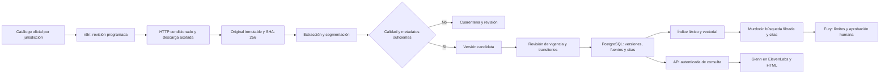

# Contracter: corpus jurídico de México y actualización verificable

Fecha de investigación documental: **4 de noviembre de 2026**, zona `America/Mexico_City`.

El usuario confirmó **todo México, incluidos los tratados internacionales**. El alcance del catálogo abarca orden federal, las 32 entidades federativas, orden municipal y demarcaciones territoriales, y los tratados que vinculen a México. La cobertura municipal queda expresamente pendiente hasta inventariar sus fuentes. Esta especificación y `legal_sources/catalog.json` son configuración y diseño: no acreditan una base ya conectada, un corpus descargado ni un actualizador publicado.

## 1. La cobertura debe poder demostrarse

No existe en esta entrega evidencia de una conexión única que contenga todas las normas mexicanas y pruebe su vigencia automáticamente. El sistema debe declarar **qué fuentes, niveles, periodos y tipos de instrumento conoce**, y abstenerse de concluir sobre la parte que no cubre.

Tres estados distintos deben permanecer separados:

- **Fuente identificada:** se conoce su autoridad y URL oficial.
- **Documento incorporado:** se descargó, conservó, extrajo e indexó una versión identificable.
- **Vigencia revisada:** un proceso documentado verificó publicación, reformas, transitorios y aplicabilidad para una fecha y jurisdicción. Que una página se descargue hoy no demuestra este tercer estado.

La interfaz debe mostrar `sin configurar`, `parcial`, `actualización pendiente`, `error de sincronización` o `revisión jurídica pendiente` cuando corresponda. El verde de una respuesta HTTP no significa que un contrato cumpla las normas.

## 2. Fuentes oficiales identificadas

| Fuente | Uso propuesto | Evidencia y límite observado |
| --- | --- | --- |
| [DOF: índice oficial](https://dof.gob.mx/index.php) | Descubrir publicaciones federales, decretos de reforma, transitorios y referencias originales. | Se pudo leer el índice. Deben recorrerse las ediciones y fechas necesarias; una captura de la portada no equivale al archivo federal completo. |
| [Cámara de Diputados: biblioteca de leyes](https://www.diputados.gob.mx/LeyesBiblio/index.htm) | Textos federales consolidados y vínculos a reformas; reconciliación contra publicaciones originales. | El índice devolvió timeout a esta herramienta. Sí se localizaron documentos oficiales, como el [Código Civil Federal](https://www.diputados.gob.mx/LeyesBiblio/pdf/CCF.pdf). Esa comprobación no certifica la vigencia de todo el catálogo. |
| [Orden Jurídico Nacional: aviso y derecho de los tratados](https://www.ordenjuridico.gob.mx/derecho_tratados.php) | Descubrimiento de compilaciones federales, estatales, municipales y de tratados. | El propio OJN califica su compilación como informativa y remite a los medios oficiales de publicación. El [índice de ámbitos](https://www.ordenjuridico.gob.mx/index_ajn.php) fue localizado en el índice de búsqueda, pero su lectura directa tuvo timeout. |
| [SRE: tratados vigentes](https://cja.sre.gob.mx/tratadosmexico/buscador) y [no vigentes](https://cja.sre.gob.mx/tratadosmexico/no-vigentes) | Identificar tratados y cambios de estado; conservar sus fichas y documentos relacionados. | Ambos listados se pudieron leer. SRE advierte su carácter informativo. Su [nota de alcance](https://cja.sre.gob.mx/tratadosmexico/info) excluye los acuerdos interinstitucionales: esa parte requiere inventario separado, no una cobertura implícita. |
| [SCJN: presentación del Semanario Judicial](https://sjfsemanal.scjn.gob.mx/presentacion) | Criterios judiciales como colección separada de las leyes, si se incorpora al alcance operativo. | La fuente explica la publicación de criterios y sus datos de fecha. Un resultado de búsqueda no basta para determinar si el criterio es obligatorio o aplicable al caso. |
| [INEGI: catálogo geográfico](https://www.inegi.org.mx/app/ageeml/) | Identificadores de entidades, municipios y demarcaciones para el inventario territorial. | Es referencia geográfica; **no es fuente normativa**. Se usa para evitar nombres ambiguos y documentar el denominador territorial. |

El manifiesto registra 32 entidades con claves y nombres, pero deja en `null` las URLs de sus legislaturas y publicaciones oficiales aún no verificadas. No se fabrican direcciones a partir del nombre del estado. Para cada entidad se incorporarán su compilación legislativa, su medio oficial y los catálogos municipales pertinentes. La falta de un enlace deja el ámbito pendiente, no excluido.

No se fija un total de leyes o municipios como denominador jurídico universal. El universo cambia y debe derivarse de un inventario fechado, con reglas explícitas para instrumentos vigentes, históricos, reglamentos, normas técnicas, disposiciones administrativas y criterios judiciales.

## 3. Arquitectura propuesta

**Recomendación técnica:** una base canónica PostgreSQL/Supabase para documentos, versiones, jurisdicción, permisos y evidencias. La búsqueda combina términos exactos de ley/artículo con similitud semántica. Supabase documenta `pgvector` y el filtrado por permisos mediante RLS; el vector es una herramienta de recuperación, no una declaración de vigencia. Véanse [columnas vectoriales](https://supabase.com/docs/guides/ai/vector-columns) y [RAG con permisos](https://supabase.com/docs/guides/ai/rag-with-permissions).

Glenn consulta una API que devuelve los mismos identificadores y versiones usados por Murdock. Así se evita que la voz responda desde una copia normativa distinta sin mostrarlo. ElevenLabs permite [herramientas webhook autenticadas](https://elevenlabs.io/docs/eleven-agents/customization/tools/webhook-tools). Su [base de conocimiento](https://elevenlabs.io/docs/eleven-agents/customization/knowledge-base/manage-documents) también permite refrescar documentos URL y configurar sincronización; si se utiliza, se registra la versión exportada y la última indexación. La función auto-sync no sustituye los controles jurídicos del corpus canónico.

El HTML no contiene claves de Supabase ni de ElevenLabs. Usa la API autorizada de Contracter; para iniciar conversaciones privadas, un backend puede obtener [URLs firmadas de ElevenLabs](https://elevenlabs.io/docs/eleven-agents/customization/authentication). Los permisos de lectura del expediente se comprueban en servidor, no mediante un `case_id` elegido por el modelo.

## 4. Modelo de datos a implementar mediante una migración separada

Este diseño no modifica `database/schema.sql` ni presupone que estas tablas ya existan.

| Tabla propuesta | Grano y campos principales | Integridad necesaria |
| --- | --- | --- |
| `legal_sources` | Una fuente: `source_id`, autoridad, URL canónica, tipo, jurisdicción, ámbito, frecuencia, estado de acceso y fechas de comprobación. | Lista permitida de orígenes; historial de cambios de URL; una fuente informativa no se reclasifica como publicación oficial. |
| `legal_documents` | Un instrumento estable: identificador oficial, título, tipo, jurisdicción, autoridad emisora y relaciones con otros instrumentos. | La identidad no depende sólo de la URL ni del nombre abreviado; una reforma se relaciona con el instrumento afectado. |
| `legal_document_versions` | Una versión: documento, publicación, descarga, hashes de binario y texto, ruta del original, versión del extractor y estado de revisión. | Original inmutable; `UNIQUE(document_id, raw_sha256)`; nunca sobrescribir silenciosamente la versión citada en un caso. |
| `legal_effectivity_reviews` | Una revisión de vigencia: versión, fecha consultada, fechas de efectos, transitorios, reservas, evidencia, revisor y motivo. | `effective_from`/`effective_to` pueden ser desconocidos. No inferir entrada en vigor a partir de la descarga. |
| `legal_chunks` | Un fragmento indexable: versión, texto exacto, artículo/sección/página si comprobados, hash, modelo de embedding y estado de indexación. | No inventar artículos ni páginas cuando el extractor no los reconoce; un embedding queda ligado a una versión y modelo concretos. |
| `legal_ingestion_runs` | Una ejecución por fuente: inicio/fin, HTTP, errores, reintentos, documentos descubiertos, cambiados y rechazados. | Registrar también fallos; no actualizar `last_successful_sync_at` por un intento fallido o una portada vacía. |
| `case_legal_evidence` | Un resultado usado en un caso: versión/chunk, cita, URL primaria, fecha de consulta, `as_of`, filtro territorial y estado de vigencia. | Preservar la evidencia histórica aunque el corpus se actualice posteriormente. |
| `legal_coverage_inventory` | Un corte por ámbito: inventario esperado, incorporado, revisado, fecha y método del denominador. | Si el universo no está inventariado, porcentaje `null` y estado `unknown`; nunca 100% por haber cargado un documento. |

Los datos de tratados necesitan además, cuando se acrediten, fechas de firma, aprobación, publicación y entrada en vigor **para México**, partes, depositario, reservas/declaraciones, enmiendas y terminación/denuncia. La fecha de adopción que aparece en un listado no se usa como sustituto de la fecha de efectos.

## 5. Workflow de actualización conectable en n8n

Nombre propuesto: **Contracter · Sincronización jurídica México**. Es un flujo separado de la auditoría contractual; una auditoría no debe esperar a descargar todo el país.

1. **Schedule Trigger + Manual Trigger:** periodicidad inicial propuesta de 12 horas para DOF/SRE y diaria para catálogos consolidados/locales; es configuración revisable, no un SLA acreditado. Fijar `America/Mexico_City`. n8n exige guardar y publicar el workflow para ejecutar el disparador programado; la zona horaria afecta su horario ([documentación oficial](https://docs.n8n.io/integrations/builtin/core-nodes/n8n-nodes-base.scheduletrigger)).
2. **Leer fuentes habilitadas:** tomar el manifiesto validado desde la base; excluir URLs desconocidas, fuentes en cuarentena o fuera del ámbito. Adquirir un bloqueo de ejecución por fuente para evitar solapamientos.
3. **HTTP Request de catálogo:** tiempo límite, tamaño máximo y reintentos acotados; verificar TLS. Enviar `If-None-Match`/`If-Modified-Since` sólo si el servidor proporcionó esos encabezados. Guardar código y encabezados. El nodo soporta métodos, encabezados, paginación y respuesta con estado ([HTTP Request](https://docs.n8n.io/integrations/builtin/core-nodes/n8n-nodes-base.httprequest)).
4. **Interpretar catálogo con adaptador por fuente:** extraer únicamente vínculos y metadatos permitidos; recorrer paginación con límite y checkpoint. Una portada, CAPTCHA, página de error o lista vacía inesperada se considera fallo de extracción. No usar un LLM para fabricar IDs o enlaces faltantes.
5. **Descargar cambios:** comparar ETag/fecha cuando existan y SHA-256 del original siempre. Limitar concurrencia y respetar las condiciones de acceso de cada sitio. Una URL redirigida fuera de la lista permitida se revisa antes de continuar.
6. **Conservar original y extraer:** guardar binario, URL final, encabezados y hash; extracción HTML/PDF en un adaptador acotado. Si requiere OCR, registrar que es OCR y sus controles de calidad. Detectar contenido vacío, tablas truncadas y artículos desaparecidos inesperadamente.
7. **Generar candidato y diff:** comparar texto y estructura; conservar reformas y transitorios asociados. Las bajas de un catálogo son señales de revisión, no órdenes para borrar una ley ni para declararla derogada.
8. **Revisión jurídica:** confirmar fechas de efectos y ámbito; resolver reformas cruzadas, reservas y discrepancias de fuentes. Un parser puede proponer metadatos, pero no promueve por sí solo una vigencia ambigua.
9. **Publicar versión revisada:** transacción para versión, relaciones, fragmentos e índices. Cambiar el puntero de búsqueda sólo cuando la indexación sea íntegra; conservar versiones anteriores para consultas históricas. La idempotencia se basa en `source_id + document_id + raw_sha256`.
10. **Cerrar ejecución y exponer estado:** guardar contadores y última sincronización exitosa por fuente. El dashboard muestra cobertura, errores, antigüedad y pendientes de revisión. Avisar al canal autorizado sólo ante cambio relevante, fallo persistente o acción requerida; no enviar mensajes rutinarios de éxito por cada ejecución.

No se ha demostrado una API pública homogénea para todos estos portales. El adaptador HTTP/HTML/PDF y sus selectores deben verificarse con respuestas reales por fuente antes de publicar el actualizador. Si un sitio impide el acceso automatizado, registrar el bloqueo y usar una exportación oficial disponible o un proceso de carga revisado; no eludir controles.

### Qué puede automatizarse y qué necesita revisión

| Automatizable después de validar el adaptador | Revisión necesaria |
| --- | --- |
| Comprobar disponibilidad, descubrir publicaciones, descargar, calcular hashes, detectar cambios, registrar ejecuciones y reindexar candidatos. | Determinar efectos jurídicos de transitorios ambiguos, resolver contradicciones, establecer aplicabilidad territorial/material, validar OCR problemático y confirmar cambios de estado de tratados. |
| Reutilizar una versión sin cambios y conservar su evidencia de consulta. | Dar por cubierto un ámbito que no tiene inventario, considerar una iniciativa como ley, equiparar texto consolidado con publicación original o emitir aprobación del contrato. |

## 6. Contrato de recuperación para Murdock y Glenn

Una petición lleva `query`, `country_code=MX`, entidades/municipios pertinentes, tipo de instrumento y `as_of`. El servidor determina el expediente y los permisos desde la sesión autenticada; los parámetros del LLM no conceden acceso.

Cada resultado incluye `source_id`, `document_id`, `version_id`, `chunk_id`, título, URL de publicación o documento primario, localizador verificable, texto exacto, hash, `retrieved_at`, fecha de publicación conocida y estado de revisión de vigencia. Los resultados con vigencia desconocida se rotulan y no fundamentan una afirmación de legalidad concluyente.

Murdock cita sólo IDs devueltos por el servidor y explica si falta cobertura. Glenn utiliza el mismo paquete de evidencia o un resumen aprobado y responde en lenguaje claro. Un resultado vacío, corpus desactualizado, ámbito sin cobertura o fuentes contradictorias produce **verificación pendiente**, no una respuesta inventada. House conserva su aislamiento: recibe conteos, banderas de fuente y estados; no el contrato ni los fragmentos jurídicos libres.

## 7. Medición y aceptación

| Indicador | Definición y denominador | Criterio propuesto |
| --- | --- | --- |
| Antigüedad de fuente | `ahora - last_successful_sync_at`, por fuente, no promedio que oculte fallos. | Mostrar pendiente si no existe fecha; umbral configurable por fuente. |
| Cobertura territorial | Entidades con inventario y sincronización verificadas / 32; municipal por inventario fechado separado. | No confundir 32 filas de configuración con 32 entidades cubiertas. |
| Cobertura documental | Versiones incorporadas o revisadas / documentos esperados en un inventario fechado. | `null` si se desconoce el denominador. |
| Evidencia trazable | Conclusiones jurídicas con cita recuperable y versión identificada / conclusiones jurídicas emitidas. | Exigir todas las conclusiones para liberar una revisión; no medirlo sólo sobre citas que sí funcionaron. |
| Demora de detección | Primera detección local menos fecha de publicación acreditada. | Mantener distribución y máximos; una consulta de portada no demuestra detección del documento. |
| Pendientes de revisión | Candidatos con cambio sin resolución, por antigüedad y ámbito. | Mostrar en la vista inicial; impedir usar como vigente un candidato incierto. |

Antes de declarar la integración operativa: ejecutar una incorporación real acotada, repetirla sin duplicados, cambiar una fixture para comprobar versionado, simular caída/HTML vacío, verificar filtros de territorio/fecha y reconstruir una cita desde su original guardado. Después comprobar que HTML, Murdock y Glenn muestran la misma versión. Estos son criterios de aceptación propuestos, no pruebas ya realizadas sobre una cuenta o base reales.

## 8. Límites concretos de esta investigación

Se verificaron páginas públicas y documentación técnica; no se usaron credenciales ni se cargó un corpus. Hubo timeouts en los índices de Cámara y OJN, aunque otras páginas oficiales sí fueron legibles. Esos resultados se conservan en el manifiesto como evidencia de acceso parcial, no como ausencia de normas. Las 32 entidades y la cobertura municipal requieren completar el inventario de fuentes oficiales. No se contrató proveedor, se ejecutó una API de pago ni se activó una sincronización.
